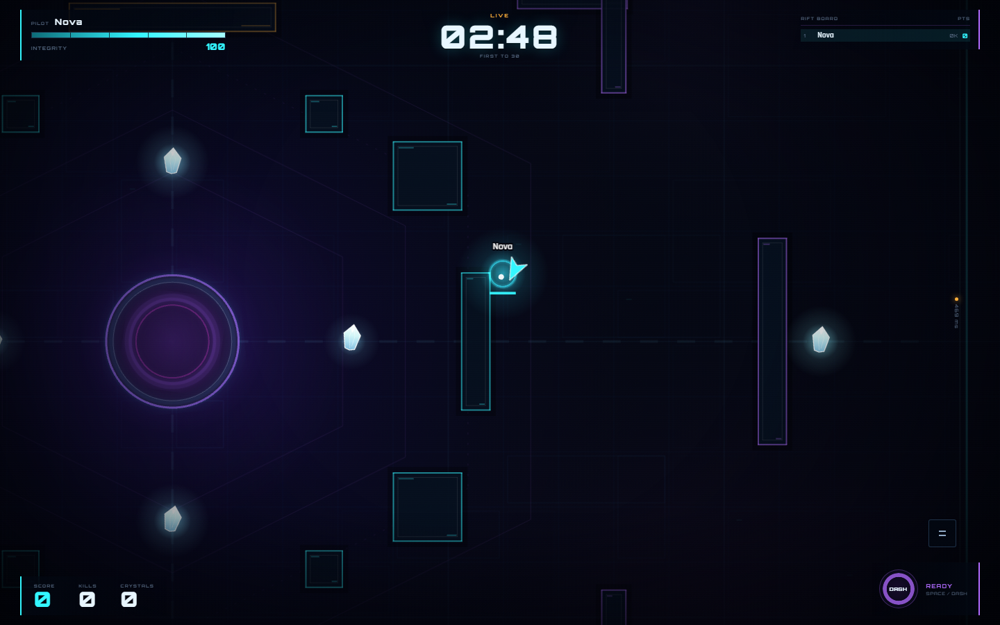
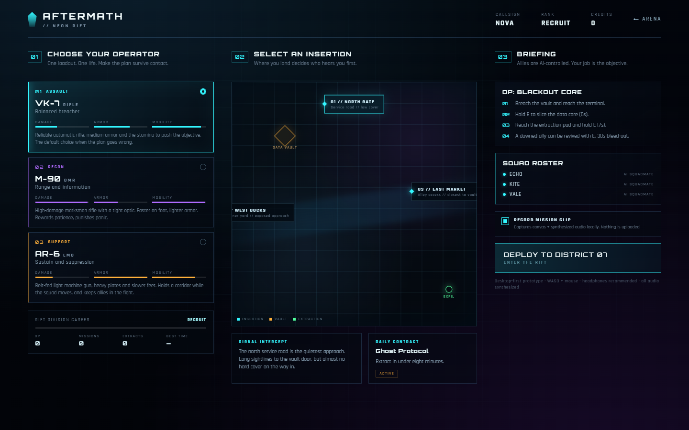
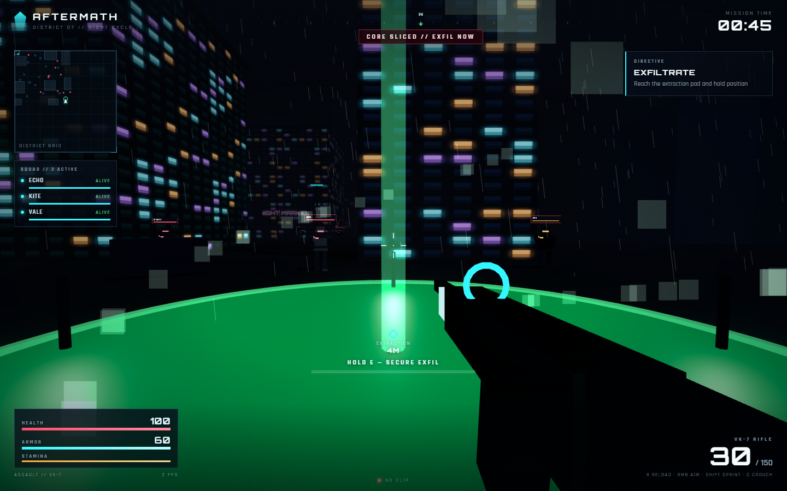

# NEON RIFT: ARENA

A complete, server-authoritative multiplayer browser arena shooter for **2–8 players**. Two to eight pilots drop into a neon top-down arena, race for crystals, hunt each other with plasma, dash through cover, and fight to the top of a live leaderboard.

Built with **Bun** (HTTP + native WebSockets + authoritative 30 Hz simulation), **Phaser 3**, **Vite** and **TypeScript**. One process serves the client and the game on the same origin — `bun run build && bun run start` is the whole deployment.

The repository also ships **AFTERMATH**, a separate 3D tactical-extraction vertical slice served at `/aftermath.html`. It is a **client-side single-player prototype** built with Three.js, not a second multiplayer game — see [AFTERMATH](#aftermath--3d-tactical-extraction-vertical-slice).



## What is actually implemented

- **Authoritative simulation** at 30 ticks/s with 15 Hz snapshots. The client only sends inputs; positions, damage, score and pickups are decided by the server.
- **Movement, aim, fire, dash** with swept collision against rectangles, circles and arena bounds. Fixed dash cooldown and spawn protection.
- **Combat**: 20 damage per bolt, 3 s respawn, spawn shield, kill credit, wall-impact effects, screen shake and synthesized audio.
- **Crystals** at eight arena spots (ten crystal entities rotating through them). Each pickup is worth 1 point and respawns after 7 s.
- **Scoring and match end**: kills are 3 points, crystals 1. Matches end on the timer or the score limit; equal scores share first place; tiebreaks only order the table.
- **Private rooms** with six-character codes (`A–H/J–N/P–Z/2–9`, no `0/O/1/I`), shareable `/play?room=CODE` invite links, ready toggles, host-controlled settings and start.
- **Quick Match** that reuses open public lobbies and auto-starts them after 8 s.
- **Rematch** for any room member and **return to lobby** for the host.
- **Reconnection** for 30 s using an opaque 32-byte session token. The same token restores identity, room and live match; token replay kicks the older socket.
- **Desktop controls** (WASD, mouse aim, click/hold fire, Space dash) and **mobile controls** (dual virtual sticks, fire and dash buttons, with the touch DASH button doubling as the cooldown gauge).
- **Client prediction and reconciliation** using the same shared movement/collision code as the server, plus 95 ms interpolation for remote players.
- **Polished UI**: menu, lobby, in-game HUD with live leaderboard, pause stack, settings, controls, results screen, toasts, invite copy/share, reconnect banner, reduced-motion/high-contrast/quality options, self-hosted fonts, and a fully synthesized audio engine (no binary audio assets).
- **Security**: strict typed protocol validation, protocol-version gate, 8 KiB frame cap, per-connection token-bucket rate limiting, origin checks, 8-strike invalid-frame disconnect, sanitized callsigns, CSP and security headers, and a test-only match-finish endpoint that is disabled by default.

## Quick start

Requirements: **Bun ≥ 1.2** (tested on Bun 1.4.4) and a modern browser. Node is only needed for the Playwright test runner.

```bash
bun install
bun run dev
```

Open `http://localhost:5173`. Vite serves the client and proxies `/ws`, `/api` and `/healthz` to the Bun server on port 3000.

### Production-style run (single origin, no Vite)

```bash
bun install
bun run build
NODE_ENV=production PORT=3000 bun run start
```

Open `http://localhost:3000`. The same server serves the SPA shell, hashed static assets, health/status endpoints, and the WebSocket upgrade at `/ws`.

On Windows PowerShell:

```powershell
$env:NODE_ENV="production"; $env:PORT="3000"; bun run start
```

### LAN play

The server binds `0.0.0.0` by default. On the host machine find the LAN address (`ipconfig` / `ip addr`) and open `http://<lan-ip>:3000` on other devices on the same network. WebSockets work over plain `ws://` on the LAN; no certificate is required for LAN IPs. For **public internet** play, put the server behind HTTPS/WSS (Railway, Fly, a reverse proxy) — see [docs/DEPLOYMENT.md](docs/DEPLOYMENT.md).

## Controls

| Action | Desktop | Touch |
| --- | --- | --- |
| Move | `W A S D` / arrow keys | Left stick |
| Aim | Mouse | Right stick |
| Fire | Left click / hold | `FIRE` |
| Dash | `Space` / `Shift` | `DASH` |
| Pause | `Esc` or the HUD button | HUD pause button |

Touch controls are auto-detected from `(pointer: coarse)` and can be forced on/off in **Settings → Touch controls**.

## AFTERMATH — 3D tactical extraction (vertical slice)

`/aftermath.html` is a self-contained Three.js entry: a first-person tactical-extraction prototype set in the same fiction, played solo against simulated hostiles. It is deliberately scoped as a **client-side vertical slice**:

- **Not multiplayer, not server-authoritative.** The player, 10 initial hostiles, 4 hack-triggered reinforcements and 3 AI allies are simulated locally in the browser. The Bun server only serves the files; there is no WebSocket, room or match state for this mode.
- **No backend progression.** Callsign, XP, credits, rank and contract state persist in `localStorage` on this device only.
- **Stylized, handcrafted visuals.** One rainy neon city block, procedural textures and synthesized audio — not an AAA production.



### Mission loop

1. **Planning** — choose one of three roles (VK-7 assault rifle, M-90 marksman rifle, AR-6 light machine gun) and one of three insertions (North Gate, West Docks, East Market); the contract and its modifiers are generated per plan.
2. **Deploy** — breach the vault terminal inside the map and hold **E** to slice the core. Slicing triggers four reinforcements and turns the objective into an exfil.
3. **Extraction** — reach the green pad and hold position while the extraction clock runs. Taking fatal damage ends the run as KIA.
4. **Results** — stats (time, kills, headshots, accuracy, damage, allies lost), XP/credits, rank progression and contract completion, then **NEW PLAN** for another run. Runs can also be captured as a clip or a still frame from the in-game controls.



Other screenshots: [mission](docs/screenshots/aftermath-mission.png), [terminal](docs/screenshots/aftermath-terminal.png), [results](docs/screenshots/aftermath-results.png).

### Controls (desktop only)

| Action | Input |
| --- | --- |
| Move | `W A S D` |
| Look | Mouse (pointer lock) |
| Fire / aim down sights | Left click / right mouse |
| Reload | `R` |
| Sprint / crouch | `Shift` / `C` |
| Interact (terminal) | `E` (hold) |
| Pause | `Esc` |

Touch devices get an explicit "desktop required" notice instead of broken controls.

### Debug API

The page exposes `window.__aftermath` for automated tests and manual debugging: `deploy(role, insertion, record)`, `teleportTerminal()`, `teleportExtraction()`, `forceHack()`, `forceExtract()`, `killPlayer()`, `revealResults()`, `setPaused(active)`, `damagePlayer(n)`, `getState()` and `getMeta()`. The Playwright suite uses it only to make objectives deterministic; movement, WebGL rendering, HUD and results are exercised for real.

## Rooms and flow

1. Enter a callsign (2–16 letters/numbers; persisted locally).
2. **Quick Match** finds a public room, or **Create Room** opens a private arena.
3. In a private room the host edits max players (2–8), duration and score limit, then starts. Readiness is visible to everyone but does not gate the host.
4. Share the room key or the invite link (`/play?room=CODE`); the link opens a prefilled join dialog with a callsign field.
5. When the match ends, any member can request a rematch; the host can return everyone to the lobby.
6. If a player drops, their pilot stays in the match for 30 s. Reopening the page in the same browser resumes the session automatically; otherwise the pilot is removed.

## Project layout

```
src/
  shared/       constants, game rules, arena geometry, collision, protocol, types
  server/       Bun HTTP app, WebSocket gateway, rooms, matchmaker, simulation, security, metrics
  client/       app controller, networking, Phaser scenes, UI controllers, styles
  aftermath/    AFTERMATH 3D slice: Three.js scene, player, AI, ballistics, HUD, planning
tests/
  unit/         physics, protocol, simulation, rate limiter
  integration/  real Bun server + real WebSocket clients
  aftermath.test.ts  pure combat/mission/rank math for the 3D slice
e2e/            Playwright: two-browser arena tests + AFTERMATH vertical slice
scripts/        dev orchestrator, DOM contract audit, E2E runner, load test
docs/           architecture, deployment, engineering report, screenshots
```

## Scripts

| Command | Purpose |
| --- | --- |
| `bun run dev` | Bun server with watch + Vite HMR |
| `bun run build` | Production client bundle into `dist/client` |
| `bun run start` | Production server (expects `dist/client`) |
| `bun run typecheck` | Strict TypeScript, no emit |
| `bun test` | Unit + integration (real server) + AFTERMATH tests |
| `bun run test:unit` | Physics/protocol/simulation/rate-limit tests |
| `bun run test:integration` | WebSocket, room, match, reconnect and security tests |
| `bun test tests/aftermath.test.ts` | AFTERMATH 3D combat, mission, loadout and rank tests |
| `bun run test:dom` | Audit that every DOM id used by client code exists |
| `bun run test:e2e` | Build + boot E2E server + Playwright suite (arena + AFTERMATH) |
| `bun run loadtest` | Measured WebSocket load test (can spawn its own server) |
| `bun run start:e2e` | Manually boot the test-mode server on port 3100 |

Example load test:

```bash
bun run loadtest --spawn --port 3200 --clients 8 --rooms 1 --duration 15
```

The script writes a JSON report under `loadtest-results/` with connect times, acknowledgement latency percentiles, snapshot rate, bandwidth and server tick statistics.

## Verification snapshot

All numbers below were produced locally on Windows with Bun 1.4.4. See [docs/ENGINEERING_REPORT.md](docs/ENGINEERING_REPORT.md) for the full record.

| Check | Result |
| --- | --- |
| `bun run typecheck` | clean |
| `bun test` | **116 passed**, 0 failed (63 unit + 26 integration + 27 AFTERMATH), 469 assertions |
| `bun run test:dom` | 112 DOM ids, 98 referenced, 0 missing |
| `bun run test:e2e` | **7 passed** (4 arena: solo, two-browser invite/rematch, phone controls, callsign persistence; 3 AFTERMATH: success flow, KIA flow, touch-notice) |
| `bun run build` | 2D: 25.14 kB HTML, 56.06 kB CSS, 86.75 kB app JS, 1,208 kB Phaser chunk (332 kB gzip). 3D: 14.06 kB HTML, 31.05 kB CSS, 90.52 kB app JS, 541 kB Three chunk (133 kB gzip) |
| AFTERMATH runtime (headed Chromium, 1440×900) | 27–28 fps, 813 draw calls during a mission; 1–9 fps under SwiftShader software rendering |
| Load, 8 clients / 1 room | 15 snapshots/s/client, ack p50 35 ms, tick avg 1.12 ms, RSS 38.9 MB |
| Load, 32 clients / 4 rooms | 15 snapshots/s/client, ack p50 37 ms, tick avg 3.01 ms, RSS 44.3 MB |

**Not verified here:** a Docker image build (the local Docker daemon was unavailable) and a real public deployment (no domain/credentials were used). Both paths are documented and the Dockerfile/CI are provided; the report labels them as prepared, not tested. Do not read this repository as a claim that they were executed on this machine. AFTERMATH performance was measured on this machine's Chromium and GPU only; other GPUs and non-Chromium engines are unmeasured.

## Security model

- Only the server mutates game state. Client input is bounded (`seq`, move vector, finite aim angle, booleans).
- Every message is versioned (`v: 1`), type-gated and validated before routing.
- Binary frames, malformed JSON, oversized frames and unknown fields are rejected; repeated abuse closes the socket.
- Token-bucket rate limit: 120 messages/s sustained, burst 240. Duplicate/equal input sequences are ignored.
- WebSocket Origin is checked against `PUBLIC_ORIGIN`, `ALLOWED_ORIGINS` and the request Host (plus `X-Forwarded-Host`). `null` and cross-site origins are rejected in production.
- Session tokens are 32 random bytes, never logged, and are single-owner: presenting one on a second socket takes over and closes the first.
- Callsigns are sanitized (control/zero-width/bidi characters stripped, length and content enforced) before broadcast.
- Static file serving is path-normalized and confined to `dist/client`; the SPA fallback only applies to extension-less HTML requests.
- `POST /api/test/finish` exists only when `ENABLE_TEST_ENDPOINTS=1`; production defaults to off.

## Limitations

- Single-process, in-memory rooms and sessions. Restarting the server ends all matches. There is no database, account system, ranking or persistent progression.
- No matchmaking by skill; Quick Match fills the first open public room.
- No in-game text chat or voice. Invite links carry room codes only.
- The protocol is JSON text frames. Snapshots are compact but not binary-encoded.
- Session tokens are single-owner: a second tab of the same browser profile takes over the session (intentional replay protection). Use separate profiles, private windows or devices for local multiplayer testing.
- E2E coverage is Chromium desktop + emulated iPhone; physical-device testing was not performed.
- **AFTERMATH is a client-side prototype**: no server authority, no netcode and no multiplayer; its AI, ballistics and mission clock all run in one browser tab.
- AFTERMATH progression lives in `localStorage` only, and there is no save/resume for a mission in progress.
- AFTERMATH targets desktop mouse + keyboard; touch devices intentionally see a notice instead of a degraded control scheme.
- AFTERMATH performance is fill-rate and draw-call bound: 27–28 fps / 813 draw calls at 1440×900 on this machine's GPU, and 1–9 fps under SwiftShader (which is why the Playwright suite allows long timeouts).
- Docker and public hosting are documented but were not executed in this environment (see above).

## Docs

- [Architecture](docs/ARCHITECTURE.md)
- [Deployment (Docker / Railway / reverse proxy / LAN)](docs/DEPLOYMENT.md)
- [Engineering report and measurements](docs/ENGINEERING_REPORT.md)

## License

MIT — see [LICENSE](LICENSE). Fonts are self-hosted Orbitron and Rajdhani under the SIL Open Font License; see `public/fonts/`.
# Neon-rift-

